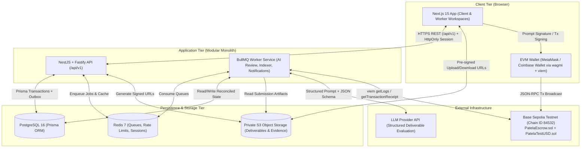
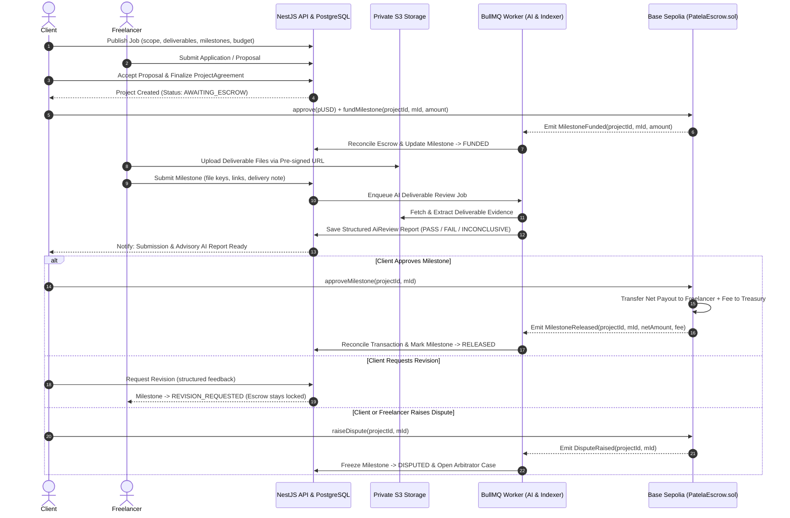
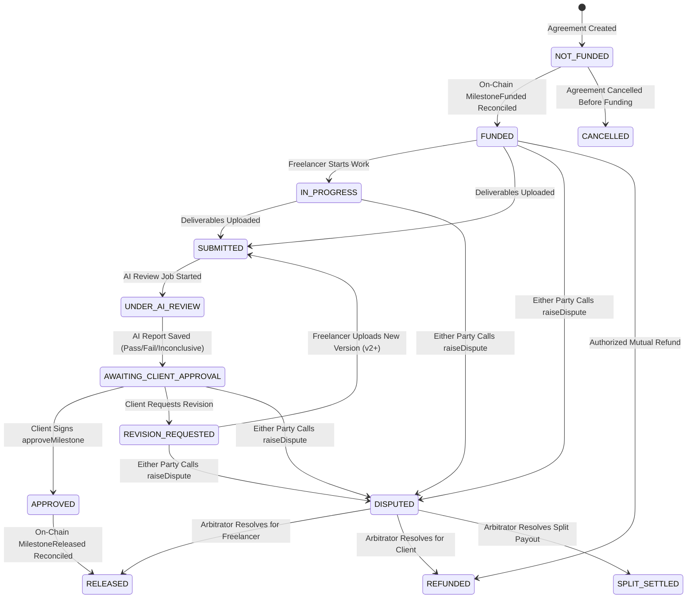
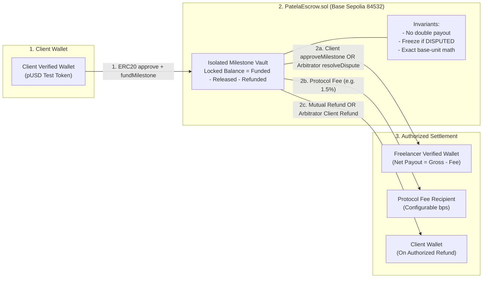
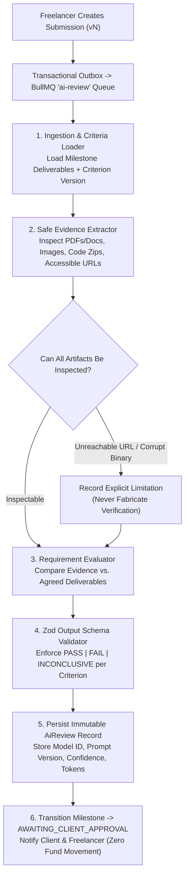
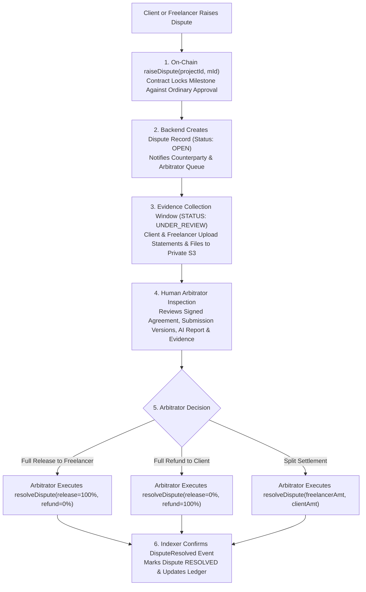
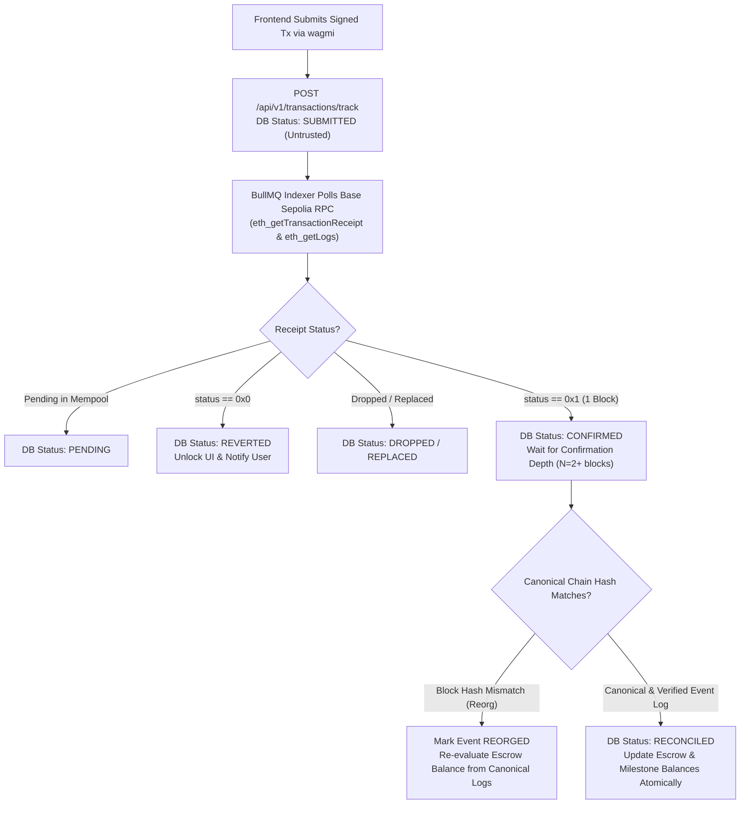

# 05 — System Architecture & Lifecycle Diagrams

**Document Version:** 1.0  
**Last Updated:** 2026-11-09  

---

## 1. Architectural Principles & Authority Boundaries

Patela uses a **Modular Monolith Backend (`apps/api`) + Dedicated Background Worker (`apps/worker`) + Smart-Contract Escrow (`contracts/`)** architecture:

1. **Authoritative Data Ownership:**
   - **Base Sepolia Smart Contract (`PatelaEscrow.sol`)** is the **sole authority** for actual token custody, locked milestone balances, on-chain approvals, dispute locks, and payout/refund transfers. The backend never holds user private keys or custodies escrow funds in an EOA wallet.
   - **PostgreSQL (`database/prisma`)** is the **authoritative store** for off-chain marketplace state: user accounts, sessions, profiles, job descriptions, proposals, project agreements, deliverable file metadata, AI review reports, dispute evidence, messages, and notifications.
   - **Blockchain Event Indexer (`apps/worker/src/blockchain-indexer`)** continuously synchronizes on-chain events (`ProjectCreated`, `MilestoneFunded`, `MilestoneSubmitted`, `MilestoneApproved`, `MilestoneReleased`, `MilestoneRefunded`, `DisputeRaised`, `DisputeResolved`) into PostgreSQL and marks records as `RECONCILED`.
2. **Trust Boundaries:**
   - **Untrusted:** Browser client inputs, unverified transaction hashes submitted by the frontend, uploaded files, and raw LLM text outputs.
   - **Trusted (After Verification):** Server-validated session cookies, verified EIP-191 wallet signatures, finalized Base Sepolia RPC event logs at confirmed block depth, and schema-validated records inside PostgreSQL.
3. **AI Authority Boundary:**
   - The AI Review Worker has **read-only access** to submission artifacts and **write access only** to the `AiReview` table. It has **zero blockchain signing keys** and **cannot invoke `approveMilestone` or `resolveDispute`**.

---

## 2. Diagram 1: Overall System Architecture

---

## 3. Diagram 2: End-to-End Client-to-Freelancer Project Lifecycle

---

## 4. Diagram 3: Milestone State Machine Lifecycle

---

## 5. Diagram 4: Escrow Funding, Custody & Release Lifecycle

---

## 6. Diagram 5: AI Deliverable Review Pipeline

---

## 7. Diagram 6: Dispute Resolution Lifecycle

---

## 8. Diagram 7: Blockchain Event Synchronization & Reconciliation

