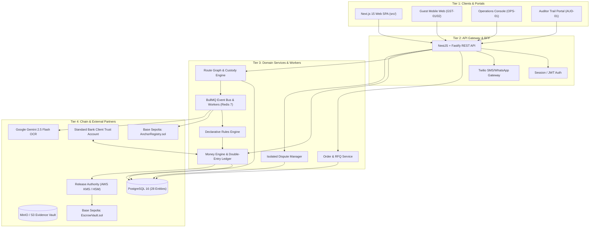

# 05 — System Architecture: Patella

**Document Version:** 1.1 (Updated for Technical Architecture v0.3)  
**Last Updated:** 2026-11-13  
**Status:** Approved Architectural Baseline

---

## 1. High-Level System Architecture

Patella coordinates B2B multi-hop supply chains across South Africa by separating high-friction operations (transport logistics and physical handoffs) from low-friction programmable settlement (declarative escrow and double-entry accounting).



---

## 2. Core Subsystems

### 2.1 Route Graph & Custody Engine
- **Directed Graph Representation:** Models any route as $G = (V, E)$, where $V$ represents physical nodes (mines, road weighbridges, rail terminals, bonded warehouses, receiving bays) and $E$ represents transit legs operated by designated freight carriers.
- **Node Proof Levels:** Each node enforces a minimum required proof level (`NONE`, `SINGLE_SIGNATURE`, `DUAL_SIGNATURE`, `BIOMETRIC_OR_PHOTO`).
- **Active Custody Tracking:** At any point in time, every consignment parcel has exactly one designated active custody holder recorded in the ledger.

### 2.2 Guest Handoff Engine (`GST-01`, `GST-02`, `GST-03`)
- **Zero App/Wallet Principle:** Frontline drivers and dock workers do not install apps or hold private keys.
- **Single-Use Ephemeral Tokens:** The gateway generates cryptographically random, short-lived tokens (4-hour TTL) dispatched via SMS/WhatsApp.
- **Simultaneous Dual Signatures:** When the driver arrives at the receiving node, both releasing and receiving parties inspect the consignment on a single mobile screen and execute distinct cryptographic signatures with optional condition photos.
- **Immediate Invalidation:** Once signed, the guest token is permanently invalidated, and the signed payload hash is broadcast to the event bus.

### 2.3 Declarative Rules Engine (Rules as Data)
- **Versioned Agreements:** Commercial agreements and payment plans are versioned (e.g. `v1.0`, `v1.1`) and cryptographically signed by both buyer and supplier.
- **JSON Rule Evaluation:** Payment release conditions are declarative data evaluated by an automated deterministic engine:
  ```json
  {
    "and": [
      { "==": [{ "var": "event.type" }, "HANDOFF_CONFIRMED"] },
      { "==": [{ "var": "event.nodeId" }, "node-richards-bay-gate"] },
      { "==": [{ "var": "event.parcelStatus" }, "INSPECTED_ACCEPTED"] }
    ]
  }
  ```
- **Immutable Precedence:** No party can unilaterally alter release rules once escrow is funded.

### 2.4 Money Engine & Conservation Invariant
- **Fundamental Law:** For every order, $\sum \text{tranches} = \text{escrowed total}$.
- **Zero Float:** No money is created, destroyed, or held in unallocated intermediate pools.
- **Three-Layer Enforcement:**
  1. REST API Request DTO Validation (`Zod` schema).
  2. PostgreSQL Double-Entry Ledger (`ledger_journal_entries` and `ledger_postings`).
  3. Solidity Smart Contract (`EscrowVault.sol` revert on tranche sum mismatch).

### 2.5 Release Authority & Chain Settlement
- **KMS/HSM Release Signature:** The smart contract never accepts plain API requests. To release funds from `EscrowVault`, the transaction must carry a cryptographic signature from the dedicated **Release Authority**, generated inside AWS KMS or Cloud HSM only after all rule checks pass.
- **Base Sepolia Execution:** The contract settles the release in `ZARP` tokens, which are automatically debited and credited via the banking partner's host-to-host API in fiat ZAR.

### 2.6 Isolated Parcel Dispute Compartmentalization
- **Consignment Partitioning:** Orders with multiple parcels (e.g. Parcel A: 300 MT, Parcel B: 100 MT) map tranches directly to specific parcels.
- **Blast Radius Containment:** If Parcel B suffers an exception (e.g. water damage at City Deep cross-dock), only Parcel B's allocated tranche (R 121,250) enters `DISPUTED` state.
- **Continuous Flow:** Parcel A's unaffected tranches (R 363,750) continue moving through the route graph and releasing to the supplier on schedule.
