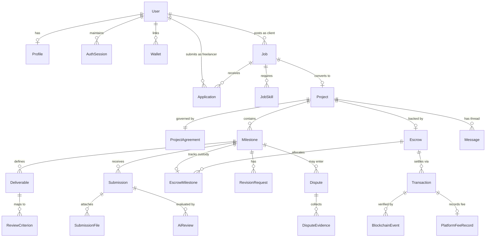

# 07 — Database Architecture & Financial Precision

**Document Version:** 1.0  
**Last Updated:** 2026-11-09  
**Target Engine:** PostgreSQL 16+ with Prisma ORM (`database/prisma/schema.prisma`)  
**Current Implementation Status:** `PLANNED` (Scheduled for [Milestone 01](./milestones/MILESTONE_01_AUTH_AND_DATABASE.md))

---

## 1. Financial Precision & Data Integrity Rules

1. **Zero Floating-Point Currency Arithmetic:**
   - JavaScript `number` (`IEEE 754` float) and SQL `FLOAT` / `REAL` / `DOUBLE PRECISION` are **strictly forbidden** for monetary or token values.
   - All token amounts in PostgreSQL are stored as **`BIGINT`** (or `NUMERIC(36, 0)` for 18-decimal tokens) representing **exact integer base units** (e.g., for 6-decimal `pUSD`, `$1,200.00` is stored as `1200000000` base units; `$0.01` is `10000` base units).
   - Every table storing an amount also records `tokenAddress`, `chainId` (`84532`), and `tokenDecimals` (`6`).
2. **ACID Transactions & Transactional Outbox:**
   - Every state-changing mutation writes its domain update, an immutable `ActivityLog` row, and an `OutboxEvent` row inside a **single `prisma.$transaction(...)`**.
3. **Idempotency Keys:**
   - Financial and submission mutations require an `Idempotency-Key` header persisted in `IdempotencyKey` (`UNIQUE (userId, key)`).
   - On-chain events use `UNIQUE (chainId, txHash, logIndex)` in `BlockchainEvent` so re-indexing the same block range is 100% idempotent.

---

## 2. Entity-Relationship Diagram (Core Domain Entities)

---

## 3. Complete Domain Table Catalog (28 Entities)

| # | Table / Model | Primary Key | Key Columns, Foreign Keys & Unique Constraints | Retention & Purpose |
|---|---|---|---|---|
| 1 | `User` | `id (UUID)` | `email (UNIQUE)`, `passwordHash`, `systemRole (USER \| ADMIN \| ARBITRATOR)`, `emailVerifiedAt`, `status`, `createdAt` | Core account identity; can act as both client and freelancer. |
| 2 | `Profile` | `id (UUID)` | `userId (FK UNIQUE)`, `displayName`, `handle (UNIQUE)`, `bio`, `headline`, `avatarObjectKey`, `companyName`, `activePersona ('CLIENT' \| 'WORKER')`, `skills (TEXT[])` | Public & workspace profile metadata. |
| 3 | `Wallet` | `id (UUID)` | `userId (FK)`, `address (CITEXT)`, `chainId (INT, default 84532)`, `isPrimary (BOOL)`, `verifiedAt`, `signatureNonce`, `UNIQUE(address, chainId)` | Cryptographically verified EVM wallets. |
| 4 | `AuthSession` | `id (UUID)` | `userId (FK)`, `tokenHash (UNIQUE)`, `ipAddress`, `userAgent`, `expiresAt`, `revokedAt` | Server-managed HTTP-only cookie sessions. |
| 5 | `Job` | `id (UUID)` | `clientId (FK -> User)`, `slug (UNIQUE)`, `title`, `category`, `description`, `budgetBaseUnits (BIGINT)`, `tokenAddress`, `tokenDecimals (SMALLINT)`, `chainId (INT)`, `deadlineAt`, `status (DRAFT \| OPEN \| HIRED \| ARCHIVED)` | Client job postings in the marketplace. |
| 6 | `JobSkill` | `id (UUID)` | `jobId (FK)`, `skillName`, `UNIQUE(jobId, skillName)` | Normalized skill tags for indexed filtering. |
| 7 | `Application` | `id (UUID)` | `jobId (FK)`, `freelancerId (FK -> User)`, `coverLetter`, `proposedAmountBaseUnits (BIGINT)`, `estimatedDays (INT)`, `portfolioLinks (JSONB)`, `status (SUBMITTED \| SHORTLISTED \| ACCEPTED \| REJECTED \| WITHDRAWN)`, `UNIQUE(jobId, freelancerId)` | Freelancer proposals on open jobs. |
| 8 | `Project` | `id (UUID)` | `jobId (FK UNIQUE)`, `clientId (FK -> User)`, `freelancerId (FK -> User)`, `code (UNIQUE, e.g. PRJ-201)`, `title`, `totalBudgetBaseUnits (BIGINT)`, `status (AWAITING_ESCROW \| IN_PROGRESS \| AWAITING_APPROVAL \| REVISION_REQUESTED \| DISPUTED \| COMPLETED \| CANCELLED)` | Active engagement workspace between client and freelancer. |
| 9 | `ProjectAgreement` | `id (UUID)` | `projectId (FK UNIQUE)`, `clientWalletAddress`, `freelancerWalletAddress`, `scopeSnapshot (TEXT)`, `deliverablesSnapshot (JSONB)`, `milestonesSnapshot (JSONB)`, `protocolFeeBps (INT)`, `clientAcceptedAt`, `freelancerAcceptedAt`, `agreementHash (CHAR(66))` | Immutable snapshot of agreed scope, milestones, and wallets. |
| 10 | `Milestone` | `id (UUID)` | `projectId (FK)`, `sequenceIndex (INT)`, `title`, `description`, `amountBaseUnits (BIGINT)`, `dueDate`, `status (NOT_FUNDED \| FUNDED \| IN_PROGRESS \| SUBMITTED \| UNDER_AI_REVIEW \| AWAITING_CLIENT_APPROVAL \| REVISION_REQUESTED \| DISPUTED \| APPROVED \| RELEASED \| REFUNDED)`, `UNIQUE(projectId, sequenceIndex)` | Sequential project milestones and amounts. |
| 11 | `Deliverable` | `id (UUID)` | `milestoneId (FK)`, `title`, `acceptanceCriteria (TEXT)`, `expectedArtifactType (FILE \| URL \| CODE \| DESIGN)`, `sortOrder (INT)` | Explicit deliverable items per milestone. |
| 12 | `ReviewCriterion` | `id (UUID)` | `deliverableId (FK)`, `version (INT)`, `criterionPrompt`, `requiredEvidenceType`, `isMandatory (BOOL)`, `UNIQUE(deliverableId, version)` | Versioned evaluation rubric consumed by the AI review worker. |
| 13 | `Submission` | `id (UUID)` | `milestoneId (FK)`, `submittedById (FK -> User)`, `versionNumber (INT)`, `deliveryNote (TEXT)`, `externalLinks (JSONB)`, `status (SUBMITTED \| AI_REVIEWED \| APPROVED \| REVISION_REQUESTED \| SUPERSEDED)`, `createdAt`, `UNIQUE(milestoneId, versionNumber)` | Versioned deliverable package submitted by freelancer. |
| 14 | `SubmissionFile` | `id (UUID)` | `submissionId (FK)`, `objectKey (UNIQUE)`, `originalFilename`, `mimeType`, `sizeBytes (BIGINT)`, `sha256Hash (CHAR(64))` | Private S3 object metadata and cryptographic file hash. |
| 15 | `AiReview` | `id (UUID)` | `submissionId (FK)`, `milestoneId (FK)`, `criteriaVersion (INT)`, `modelProvider`, `modelName`, `promptVersion`, `overallStatus (PASSED \| FAILED \| INCONCLUSIVE \| ERROR)`, `confidenceScore (SMALLINT 0-100)`, `structuredResults (JSONB)`, `summaryExplanation (TEXT)`, `limitations (TEXT)`, `SuggestedRevisions (TEXT)`, `completedAt` | Immutable advisory AI verification report. |
| 16 | `RevisionRequest` | `id (UUID)` | `milestoneId (FK)`, `submissionId (FK)`, `requestedById (FK -> User)`, `feedbackNote (TEXT)`, `missingDeliverableIds (UUID[])`, `resolvedAt` | Structured client revision instructions. |
| 17 | `Escrow` | `id (UUID)` | `projectId (FK UNIQUE)`, `chainId (INT)`, `contractAddress`, `onChainProjectId (CHAR(66) UNIQUE)`, `tokenAddress`, `tokenDecimals (SMALLINT)`, `totalDepositedBaseUnits (BIGINT)`, `totalReleasedBaseUnits (BIGINT)`, `totalRefundedBaseUnits (BIGINT)`, `lockedBalanceBaseUnits (BIGINT)`, `reconciledAt` | Project-level on-chain escrow custody ledger. |
| 18 | `EscrowMilestone` | `id (UUID)` | `escrowId (FK)`, `milestoneId (FK UNIQUE)`, `onChainMilestoneIndex (INT)`, `fundedBaseUnits (BIGINT)`, `releasedBaseUnits (BIGINT)`, `refundedBaseUnits (BIGINT)`, `feePaidBaseUnits (BIGINT)`, `onChainStatus (ENUM)`, `lastReconciledBlock (BIGINT)` | Per-milestone on-chain balance and state reconciliation. |
| 19 | `Transaction` | `id (UUID)` | `projectId (FK NULLABLE)`, `milestoneId (FK NULLABLE)`, `escrowId (FK NULLABLE)`, `initiatedById (FK -> User)`, `txType (ESCROW_DEPOSIT \| MILESTONE_RELEASE \| MILESTONE_REFUND \| DISPUTE_RAISE \| DISPUTE_SETTLEMENT)`, `chainId (INT)`, `txHash (CHAR(66))`, `fromAddress`, `toAddress`, `grossAmountBaseUnits (BIGINT)`, `feeAmountBaseUnits (BIGINT)`, `netAmountBaseUnits (BIGINT)`, `blockNumber (BIGINT NULLABLE)`, `status (SUBMITTED \| PENDING \| CONFIRMED \| RECONCILED \| FAILED \| REVERTED \| REPLACED \| DROPPED \| REORGED)`, `UNIQUE(chainId, txHash)` | Lifecycle tracking for every blockchain transaction. |
| 20 | `BlockchainEvent` | `id (UUID)` | `chainId (INT)`, `contractAddress`, `txHash (CHAR(66))`, `blockNumber (BIGINT)`, `blockHash (CHAR(66))`, `logIndex (INT)`, `eventName`, `decodedPayload (JSONB)`, `canonicalStatus (CANONICAL \| REORGED)`, `processedAt`, `UNIQUE(chainId, txHash, logIndex)` | Raw indexed logs from Base Sepolia for deterministic replay and reorg recovery. |
| 21 | `PlatformFeeRecord` | `id (UUID)` | `transactionId (FK UNIQUE)`, `projectId (FK)`, `milestoneId (FK)`, `feeBps (INT)`, `feeAmountBaseUnits (BIGINT)`, `recipientAddress`, `settledAt` | Accounting ledger for protocol fees collected on release. |
| 22 | `Dispute` | `id (UUID)` | `projectId (FK)`, `milestoneId (FK)`, `raisedById (FK -> User)`, `assignedArbitratorId (FK -> User NULLABLE)`, `reasonCategory`, `description`, `onChainDisputeTxHash`, `status (OPEN \| EVIDENCE_COLLECTION \| UNDER_REVIEW \| RESOLVED_FREELANCER \| RESOLVED_CLIENT \| RESOLVED_SPLIT \| CANCELLED)`, `resolutionSummary`, `freelancerAwardBaseUnits (BIGINT NULLABLE)`, `clientRefundBaseUnits (BIGINT NULLABLE)`, `resolutionTxHash`, `resolvedAt` | Human-arbitrated milestone dispute record. |
| 23 | `DisputeEvidence` | `id (UUID)` | `disputeId (FK)`, `submittedById (FK -> User)`, `statement (TEXT)`, `objectKey (NULLABLE)`, `mimeType`, `sha256Hash`, `createdAt` | Client and freelancer dispute evidence submissions. |
| 24 | `Message` | `id (UUID)` | `projectId (FK)`, `senderId (FK -> User)`, `body (TEXT)`, `attachmentObjectKey (NULLABLE)`, `createdAt` | Project workspace communication thread. |
| 25 | `Notification` | `id (UUID)` | `userId (FK)`, `type`, `title`, `body`, `actionHref`, `metadata (JSONB)`, `readAt (NULLABLE)`, `createdAt` | In-app user notifications. |
| 26 | `ActivityLog` | `id (UUID)` | `actorId (FK -> User NULLABLE)`, `actorType (USER \| SYSTEM \| AI_WORKER \| INDEXER \| ARBITRATOR)`, `entityType`, `entityId (UUID)`, `action`, `previousState (JSONB)`, `newState (JSONB)`, `ipAddress`, `createdAt` | Append-only audit log for all domain and admin actions. |
| 27 | `IdempotencyKey` | `id (UUID)` | `userId (FK)`, `idempotencyKey (VARCHAR(128))`, `requestMethod`, `requestPath`, `requestHash`, `responseStatus (INT)`, `responseBody (JSONB)`, `expiresAt`, `UNIQUE(userId, idempotencyKey)` | Prevents duplicate financial, job, or submission mutations. |
| 28 | `OutboxEvent` | `id (UUID)` | `aggregateType`, `aggregateId (UUID)`, `eventType`, `payload (JSONB)`, `status (PENDING \| PUBLISHED \| FAILED)`, `retryCount (INT)`, `createdAt`, `publishedAt` | Transactional outbox guaranteeing reliable BullMQ job dispatch. |

---

## 4. Database Indexing, Constraints & Migration Strategy

- **Mandatory Check Constraints:**
  - `Milestone`: `amountBaseUnits > 0`
  - `Escrow`: `lockedBalanceBaseUnits = totalDepositedBaseUnits - totalReleasedBaseUnits - totalRefundedBaseUnits` AND `lockedBalanceBaseUnits >= 0`
  - `Dispute`: When resolved, `COALESCE(freelancerAwardBaseUnits, 0) + COALESCE(clientRefundBaseUnits, 0) <= milestone.amountBaseUnits`
- **Performance Indexes:**
  - `Job(status, category, createdAt DESC)` for marketplace browsing.
  - `Project(clientId, status)` and `Project(freelancerId, status)` for dashboard overviews.
  - `Transaction(projectId, createdAt DESC)` and `Transaction(status, chainId)` for ledger and indexer queries.
  - `Notification(userId, readAt, createdAt DESC)` for topbar unread badge queries.
- **Migration Strategy:**
  - Managed via `prisma migrate dev` in local development and `prisma migrate deploy` in CI/Staging/Testnet.
  - Raw SQL migration hooks add PostgreSQL `CHECK` constraints that Prisma's declarative syntax does not natively emit.

