# 14 — Complete Testnet MVP Development Roadmap

**Document Version:** 1.0  
**Last Updated:** 2026-11-09  

---

## 1. Roadmap Overview & Milestone Sequence

```mermaid
flowchart LR
  M00["M00: Foundation &\nCodebase Audit\n(IN_PROGRESS)"] --> M01["M01: Auth &\nPostgreSQL Database\n(PLANNED)"]
  M01 --> M02["M02: Marketplace &\nApplications\n(PLANNED)"]
  M02 --> M03["M03: Project Management &\nPrivate S3 Submissions\n(PLANNED)"]
  M03 --> M04["M04: Wallet & Base Sepolia\nSmart-Contract Escrow\n(PLANNED)"]
  M04 --> M05["M05: AI Deliverable\nReview Worker\n(PLANNED)"]
  M05 --> M06["M06: Human Dispute\nResolution\n(PLANNED)"]
  M06 --> M07["M07: Reconciled Analytics &\nAdmin Console\n(PLANNED)"]
  M07 --> M08["M08: Testing, Security &\nBase Sepolia Release\n(PLANNED)"]
```

---

## 2. Milestone Summary Table

| Milestone | Document Link | Objective | Key Deliverables | Current Status |
|---|---|---|---|---|
| **M00** | [`MILESTONE_00_FOUNDATION.md`](./milestones/MILESTONE_00_FOUNDATION.md) | Audit repository, establish `intel/` documentation system, define target architecture, shared types/validation conventions, and dev tooling. | `intel/` documentation system (`COMPLETED`), `AUDIT_REPORT.md` (`COMPLETED`), shared workspace setup (`FND-004`–`FND-007`). | `IN_PROGRESS` |
| **M01** | [`MILESTONE_01_AUTH_AND_DATABASE.md`](./milestones/MILESTONE_01_AUTH_AND_DATABASE.md) | Establish PostgreSQL + Prisma database, Argon2id registration/login, stateful HTTP-only sessions, unified Client/Freelancer profiles, and RBAC. | Docker Compose (PG/Redis/MinIO), Prisma schema & migrations, NestJS `/api/v1/auth/*` & `/api/v1/users/*`, auth integration tests. | `PLANNED` |
| **M02** | [`MILESTONE_02_MARKETPLACE.md`](./milestones/MILESTONE_02_MARKETPLACE.md) | Make Patela a persistent freelance marketplace with job CRUD, deliverable definitions, search/filtering, proposals, and hiring. | `/api/v1/jobs/*`, `/api/v1/applications/*`, Next.js marketplace & post-job connected to PostgreSQL, hiring state transitions. | `PLANNED` |
| **M03** | [`MILESTONE_03_PROJECT_MANAGEMENT.md`](./milestones/MILESTONE_03_PROJECT_MANAGEMENT.md) | Convert accepted proposals into structured projects with immutable agreements, milestones, private S3 file submissions, revisions, messaging, and notifications. | `/api/v1/projects/*`, `/api/v1/milestones/*`, `/api/v1/submissions/*`, private S3 pre-signed uploads, role-aware Next.js project workspace. | `PLANNED` |
| **M04** | [`MILESTONE_04_WALLET_AND_ESCROW.md`](./milestones/MILESTONE_04_WALLET_AND_ESCROW.md) | Implement real Base Sepolia (`84532`) wallet linking, `PatelaTestUSD` (`pUSD`), `PatelaEscrow.sol` smart contract, milestone funding, approval release, refunds, and event indexing. | Foundry contracts + unit/fuzz/invariant tests, `wagmi` + `viem` integration, BullMQ blockchain indexer, reconciled transaction ledger. | `PLANNED` |
| **M05** | [`MILESTONE_05_AI_REVIEW.md`](./milestones/MILESTONE_05_AI_REVIEW.md) | Implement asynchronous AI-assisted deliverable evaluation comparing uploaded evidence against agreed deliverable criteria. | BullMQ `ai-review` worker, safe evidence extractor, Zod-validated `PASS`/`FAIL`/`INCONCLUSIVE` reports, criteria versioning, UI report view. | `PLANNED` |
| **M06** | [`MILESTONE_06_DISPUTE_RESOLUTION.md`](./milestones/MILESTONE_06_DISPUTE_RESOLUTION.md) | Establish on-chain dispute lock (`raiseDispute`), evidence collection, and human arbitrator resolution (`resolveDispute`). | `/api/v1/disputes/*`, private evidence uploads, Arbitrator resolution console, on-chain split/release/refund settlement reconciliation. | `PLANNED` |
| **M07** | [`MILESTONE_07_ANALYTICS_AND_ADMIN.md`](./milestones/MILESTONE_07_ANALYTICS_AND_ADMIN.md) | Connect Client & Freelancer financial dashboards to reconciled DB/chain records and build the platform Administration console. | `/api/v1/analytics/*`, `/api/v1/admin/*`, reconciled SVG financial charts in Next.js, platform fee ledger & audit log viewer. | `PLANNED` |
| **M08** | [`MILESTONE_08_TESTING_AND_TESTNET_RELEASE.md`](./milestones/MILESTONE_08_TESTING_AND_TESTNET_RELEASE.md) | Complete end-to-end Playwright testing, Foundry invariant/security review, Base Sepolia deployment & BaseScan verification, and testnet onboarding. | Verified Base Sepolia contracts, `pUSD` testnet faucet/onboarding, full E2E test suite passing, final MVP acceptance sign-off. | `PLANNED` |

---

## 3. Recommended Execution Order

1. **Finish Milestone 00 Foundation Tasks (`FND-004`–`FND-007`):** Finalize workspace scripts, `.env.example`, and shared validation package structure.
2. **Execute Milestone 01 (`DB-001`–`DB-012`):** Stand up PostgreSQL + Prisma and NestJS authentication before building any feature endpoints.
3. **Proceed sequentially through `M02 → M03 → M04 → M05 → M06 → M07 → M08`**, satisfying every quality gate in [`12_TESTING_AND_QUALITY.md`](./12_TESTING_AND_QUALITY.md) before advancing.

