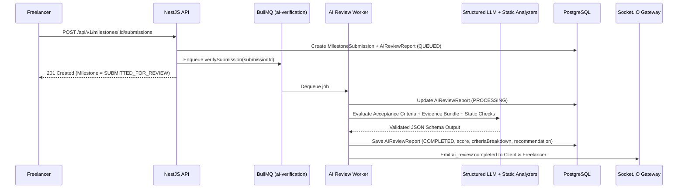

# AI Deliverable Verification Specification

> **Classification:** Feature Technical Specification  
> **Status:** `Simulated / Buggy` (`src/lib/patela-store.ts` auto-approves on pass — `ISS-001`; `html/ai-reviews.html` is static demo data)  
> **Target Milestone:** [MILESTONE_05_AI_REVIEW.md](../milestones/MILESTONE_05_AI_REVIEW.md)  
> **Last Updated:** 2026-11-09  

---

## 1. Current Repository State & Critical Bug (`ISS-001`)

- **`src/lib/patela-store.ts`:** Contains `demoReview()`, a synchronous keyword/length heuristic. **Critical Violation (`ISS-001`):** In `submitMilestone()`, if `review.passed` is `true`, `patela-store.ts` immediately sets the milestone status to `"approved"` and releases funds without waiting for client review.
- **`html/ai-reviews.html`:** Correctly models the target UX where AI Verification (`96/100` confidence ring, requirement-by-requirement breakdown, code/security checks, and recommendation badge) is **advisory**, leaving the final `Approve & Release Escrow` or `Request Revisions` action to the client.

---

## 2. Core Architectural Rule: Advisory Boundary

> **NON-NEGOTIABLE INVARIANT:** The AI Verification Service is an asynchronous, deterministic-schema **advisory auditor**. Completing an AI review—even with a `100/100` score and `RECOMMEND_APPROVAL` verdict—**never** transitions a milestone to `RELEASED` and **never** invokes `PatelaEscrow.sol`. Only the Client (via on-chain signature) or an Admin Arbitrator (during a dispute) can release funds.

---

## 3. Asynchronous Verification Pipeline

Full pipeline details are documented in [../10_AI_REVIEW_SYSTEM.md](../10_AI_REVIEW_SYSTEM.md).

---

## 4. Structured Evaluation Rubric & Output Schema

Every `AIReviewReport` (`ai_review_reports` table) produces a strict JSON schema validated with `zod`:

1. **`overallScore`** (`0`–`100` integer):
   - **Completeness (`40%`)**: Coverage of each milestone acceptance criterion.
   - **Technical Quality & Evidence Integrity (`35%`)**: Validity of repository links, commit hashes, file checksums, and deliverable artifacts.
   - **Documentation & Verification Clarity (`25%`)**: Reproducibility and explanation quality in `summaryMarkdown`.
2. **`recommendation`** (`Enum`):
   - `RECOMMEND_APPROVAL` ($\text{score} \ge 80$ and zero `FAILED` mandatory criteria)
   - `NEEDS_CLIENT_INSPECTION` ($60 \le \text{score} < 80$ or partial criteria coverage)
   - `RECOMMEND_REVISION` ($\text{score} < 60$ or missing core deliverables)
3. **`criteriaResults[]`**: Array mapping each milestone acceptance criterion to `{ criterion, status: 'MET' | 'PARTIAL' | 'UNMET', confidence: 0..100, evidenceCitation, reasoning }`.
4. **`riskFlags[]`**: Array of detected anomalies (e.g., unreachable URL, empty archive, placeholder text, prompt-injection attempt).
5. **`promptVersion` & `modelIdentifier`**: Recorded for auditability and reproducibility.

---

## 5. Prompt-Injection Defense

All freelancer-supplied text (`summaryMarkdown`, file names, code comments) is wrapped inside untrusted XML delimiters (`<untrusted_submission_evidence>...</untrusted_submission_evidence>`) with system instructions explicitly forbidding the model from following instructions found inside submission payloads.

---

## 6. Acceptance Criteria

- [ ] `ISS-001` is eliminated: a `100/100` AI review leaves the milestone in `SUBMITTED_FOR_REVIEW` awaiting explicit client action.
- [ ] If the LLM provider times out or fails after 3 exponential backoff retries, `AIReviewReport.status` is set to `FAILED_MANUAL_REVIEW_REQUIRED` and the client can still manually inspect and approve the submission.
- [ ] Both client and freelancer can inspect the full criterion-by-criterion breakdown in the AI Verification Hub (`/dashboard/ai-reviews`).

