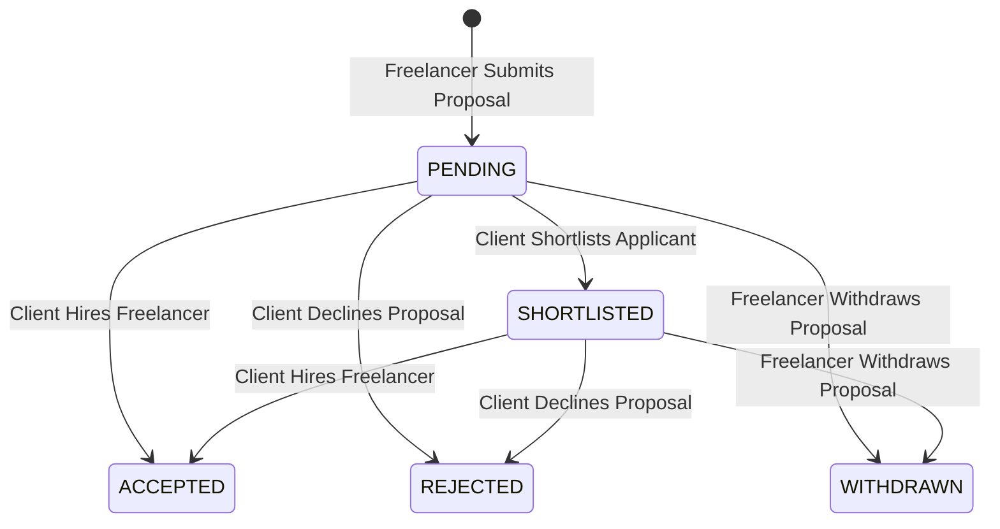

# Freelancer Applications & Proposals Specification

> **Classification:** Feature Technical Specification  
> **Status:** `Prototype Only` (`html/jobs.html` proposal modal; missing in `src/`)  
> **Target Milestone:** [MILESTONE_02_MARKETPLACE.md](../milestones/MILESTONE_02_MARKETPLACE.md)  
> **Last Updated:** 2026-11-09  

---

## 1. Current Repository State

- **`src/` (Next.js App):** Does **not** have a proposal/application workflow (`ISS-005`). Any visitor can immediately submit work to a job without applying or being hired.
- **`html/` (Dashboard Prototype):** `html/jobs.html` includes a working `Submit Proposal` modal in Worker View and a `Proposals` review list in Client View, stored in browser `localStorage`.

---

## 2. Application Lifecycle State Machine

---

## 3. Functional Requirements

### 3.1 Submitting a Proposal (Freelancer)
To apply to an `OPEN` job, an authenticated freelancer must:
1. Have at least one verified primary wallet (`UserWallet`) configured for payouts.
2. Not be the client who posted the job (`job.clientId !== user.id`).
3. Not already have an active (`PENDING`, `SHORTLISTED`, or `ACCEPTED`) application for the same `jobId` (enforced by unique database constraint `@@unique([jobId, freelancerId])`).
4. Provide:
   - `coverLetter` (min 50 characters, max 5,000 characters).
   - `proposedTotalAmount` (in token base units; defaults to `job.totalBudgetAmount`).
   - `estimatedDurationDays` (integer $\ge 1$).
   - `portfolioLinks[]` (optional URLs to relevant repositories or case studies).
   - Optional `proposedMilestones[]` (if proposing a modified milestone breakdown; sum must equal `proposedTotalAmount`).

### 3.2 Reviewing & Accepting a Proposal (Client)
- The job owner (`job.clientId`) can view all applications for their job, sorted by freelancer trust score or submission date.
- When the client clicks **Accept Proposal & Create Project** (`POST /api/v1/applications/:id/accept`):
  Inside a single PostgreSQL serializable transaction:
  1. Verify `job.status === 'OPEN'`.
  2. Set the target application to `ACCEPTED`.
  3. Set all other `PENDING` / `SHORTLISTED` applications for that `jobId` to `REJECTED`.
  4. Transition `job.status` to `IN_CONTRACT`.
  5. Create a new `Project` linking `clientId`, `freelancerId`, `jobId`, `applicationId`, `paymentToken`, and `totalAmount`.
  6. Instantiate `Milestone` rows from the agreed milestone breakdown with initial status `AWAITING_FUNDING`.
  7. Create a project `Conversation` thread and emit notifications to both client and freelancer.

---

## 4. API Endpoints

| Method | Endpoint | Auth | Description |
|---|---|---|---|
| `POST` | `/api/v1/jobs/:jobId/applications` | JWT (`FREELANCER`) | Submit a proposal for an `OPEN` job |
| `GET` | `/api/v1/jobs/:jobId/applications` | JWT (Job Owner) | List all proposals submitted for a specific job |
| `GET` | `/api/v1/applications/me` | JWT (`FREELANCER`) | List all proposals submitted by the authenticated freelancer |
| `PATCH` | `/api/v1/applications/:id/status` | JWT (Job Owner) | Shortlist or reject an application |
| `POST` | `/api/v1/applications/:id/accept` | JWT (Job Owner) | Accept proposal and atomically generate `Project` + `Milestones` |
| `POST` | `/api/v1/applications/:id/withdraw` | JWT (Applicant) | Withdraw a `PENDING` or `SHORTLISTED` proposal |

---

## 5. Acceptance Criteria

- [ ] A freelancer cannot submit duplicate applications to the same job (`409 Conflict`).
- [ ] Accepting an application atomically creates the `Project` and its `Milestone` records and prevents any second application from being accepted.
- [ ] Nobody can submit deliverable evidence to a project unless they are the assigned `project.freelancerId`.

