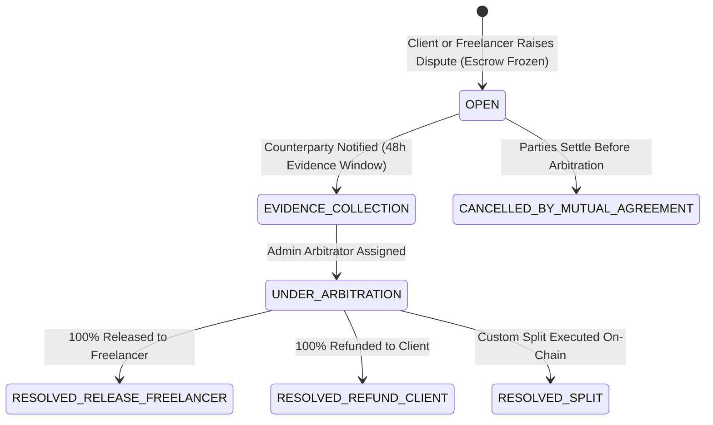

# Dispute Resolution & Arbitration Specification

> **Classification:** Feature Technical Specification  
> **Status:** `Prototype Only` (`src/app/jobs/[jobId]/job-view.tsx` status flag; `html/disputes.html` interactive prototype)  
> **Target Milestone:** [MILESTONE_06_DISPUTE_RESOLUTION.md](../milestones/MILESTONE_06_DISPUTE_RESOLUTION.md)  
> **Last Updated:** 2026-11-09  

---

## 1. Current Repository State

- **`src/` (Next.js App):** Allows clicking a button to mark a milestone `"disputed"` in `localStorage`, with no evidence collection, escrow freeze transaction, or resolution flow (`ISS-007`).
- **`html/` (Dashboard Prototype):** `html/disputes.html` provides a Dispute Resolution Center with case cards, frozen escrow banners, evidence timelines, AI verification references, and full-screen case detail views.

---

## 2. Dispute Lifecycle State Machine

---

## 3. Functional Requirements

### 3.1 Raising a Dispute & Freezing Escrow
- **Eligible Milestones:** Any milestone in `FUNDED`, `IN_PROGRESS`, `SUBMITTED_FOR_REVIEW`, or `REVISION_REQUESTED`.
- **Initiators:** Only `project.clientId` or `project.freelancerId`.
- **Required Payload:**
  - `reasonCategory`: `INCOMPLETE_DELIVERABLE`, `MISSED_DEADLINE`, `UNRESPONSIVE_COUNTERPARTY`, `SCOPE_DISAGREEMENT`, or `QUALITY_BELOW_CRITERIA`.
  - `statementMarkdown`: Detailed explanation (min 100 chars).
  - `proposedResolution`: `FULL_REFUND`, `FULL_RELEASE`, or `PARTIAL_SPLIT` (with proposed basis points).
- **On-Chain Freeze:** Opening a dispute invokes `raiseDispute(onchainMilestoneId)` on `PatelaEscrow.sol` (or queues an arbitrator freeze transaction), locking the milestone funds so neither party can unilaterally withdraw or release them.

### 3.2 Evidence Bundle & Counterparty Response
- Both client and freelancer can upload counter-evidence (`DisputeEvidence` rows with S3 attachments and SHA-256 hashes) during the `OPEN` and `EVIDENCE_COLLECTION` states.
- The system automatically attaches an immutable snapshot of:
  1. Original milestone acceptance criteria.
  2. All `MilestoneSubmission` versions (`v1..vN`) and their `bundleSha256` hashes.
  3. All `AIReviewReport` outputs and criterion scores.
  4. Project `Conversation` message transcript.

### 3.3 Admin Arbitration & On-Chain Settlement
- An authenticated `UserRole.ADMIN` arbitrator reviews the case in the Admin Arbitration Console (`/dashboard/admin/disputes/:id`).
- The arbitrator records a written `resolutionSummaryMarkdown` and executes `resolveDispute(onchainMilestoneId, clientRefundAmount, freelancerPayoutAmount)` on `PatelaEscrow.sol`.
- Once the Base Sepolia transaction is confirmed:
  - `Dispute.status` transitions to `RESOLVED_RELEASE_FREELANCER`, `RESOLVED_REFUND_CLIENT`, or `RESOLVED_SPLIT`.
  - `Milestone.status` transitions to `RELEASED`, `REFUNDED`, or `SPLIT_RESOLVED`.

---

## 4. API Endpoints

| Method | Endpoint | Auth | Description |
|---|---|---|---|
| `POST` | `/api/v1/milestones/:milestoneId/disputes` | JWT (Participant) | Open a dispute on a funded milestone |
| `GET` | `/api/v1/disputes` | JWT | List disputes involving the user (or all disputes for `ADMIN`) |
| `GET` | `/api/v1/disputes/:disputeId` | JWT (Participant / `ADMIN`) | Fetch full dispute case, evidence timeline, and AI audit snapshot |
| `POST` | `/api/v1/disputes/:disputeId/evidence` | JWT (Participant) | Submit additional evidence or statement |
| `POST` | `/api/v1/admin/disputes/:disputeId/resolve` | JWT (`ADMIN`) | Record arbitration ruling and verify on-chain settlement tx |

---

## 5. Acceptance Criteria

- [ ] A milestone in `DISPUTED` status cannot be approved/released via the normal client release endpoint (`409 Conflict`).
- [ ] Arbitrator split amounts must satisfy `clientRefundBaseUnits + freelancerPayoutBaseUnits == milestoneLockedBaseUnits`.
- [ ] Every action in a dispute (`OPENED`, `EVIDENCE_ADDED`, `RESOLVED`) is logged in `audit_logs`.

