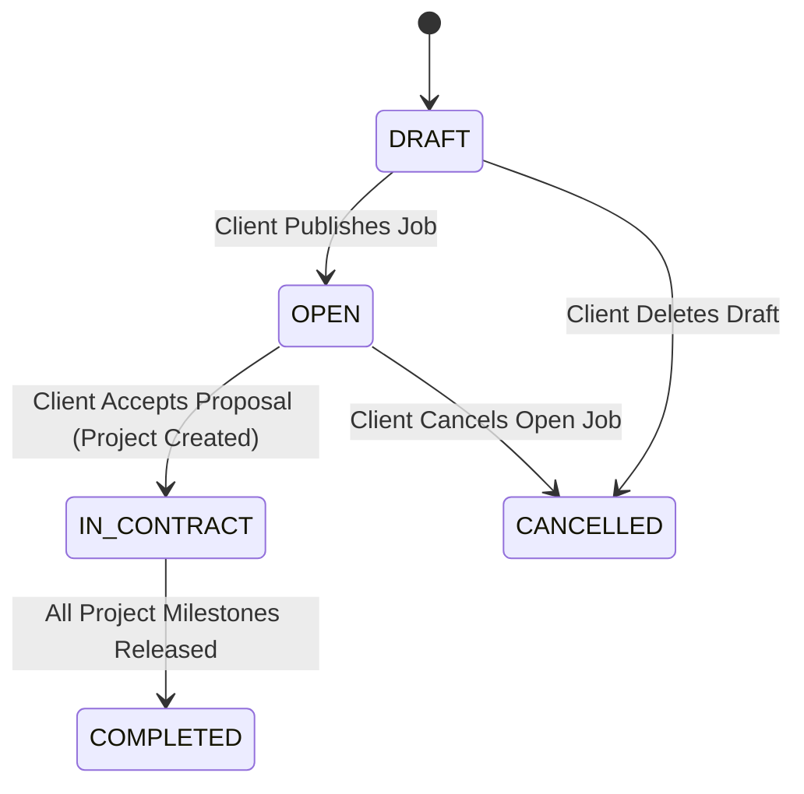

# Marketplace & Job Posting Specification

> **Classification:** Feature Technical Specification  
> **Status:** `Prototype Only` (`src/app/marketplace`, `src/app/post-job`, `html/jobs.html`)  
> **Target Milestone:** [MILESTONE_02_MARKETPLACE.md](../milestones/MILESTONE_02_MARKETPLACE.md)  
> **Last Updated:** 2026-11-09  

---

## 1. Current Repository State

- **`src/` (Next.js App):**
  - `/marketplace` (`src/app/marketplace/marketplace-view.tsx`) displays open/active jobs from `patela-store.ts` with search, category filter, and status filter.
  - `/post-job` (`src/app/post-job/post-job-view.tsx`) allows creating a job with dynamic milestones and an auto-split `50% / 30% / 20%` helper (`splitMilestones()`), persisted in `localStorage`.
- **`html/` (Dashboard Prototype):**
  - `html/jobs.html` provides role-aware job browsing, search, category/token filters, a `Post New Job` modal for clients, and full-screen job detail drawers (`interactions.js`).

---

## 2. Job Lifecycle State Machine

| State | Description | Allowed Actions |
|---|---|---|
| `DRAFT` | Saved by client but not visible in public marketplace | Edit, Publish (`OPEN`), Cancel |
| `OPEN` | Visible in marketplace; accepting freelancer applications | Submit Application, Edit Description, Close/Cancel |
| `IN_CONTRACT` | Freelancer hired and active `Project` created | View linked Project |
| `COMPLETED` | Linked `Project` completed | Read-only archive |
| `CANCELLED` | Closed before hiring a freelancer | Read-only archive |

---

## 3. Functional Requirements

### 3.1 Job Creation & Milestone Templates
Every job posted on Patela must define:
- `title` (10–140 chars), `category` (`Smart Contracts`, `Frontend & UX`, `Backend & APIs`, `AI & Verification`, `Security Audit`, `Design Systems`), `summary`, `descriptionMarkdown`, and `acceptanceCriteria[]`.
- `paymentToken`: `USDC` (6 decimals), `USDT` (6 decimals), or `ETH` (18 decimals) on Base Sepolia (`84532`).
- `totalBudgetAmount` (stored as `BigInt` base units in `jobs.total_budget_amount`).
- `milestoneTemplates[]` (1 to 10 milestones):
  - Each milestone template has `sequenceIndex`, `title`, `description`, `deliverableType` (`CODE_REPO`, `DESIGN_ASSET`, `DOCUMENT`, `DEPLOYMENT_URL`), `acceptanceCriteria[]`, `amount`, and `dueInDays`.
  - **Invariant:** $\sum \text{milestoneTemplate.amount} == \text{job.totalBudgetAmount}$. The backend rejects any job creation or update where the milestone sum does not equal the total budget.

### 3.2 Marketplace Discovery, Search & Filtering
- Supports full-text search (`title`, `summary`, `skills`), category filtering, payment token filtering (`USDC`, `USDT`, `ETH`), budget range filtering, and sorting (`Newest`, `Budget: High to Low`, `Most Applications`).
- Cursor-based pagination (`limit` default `20`, max `50`).

---

## 4. API Endpoints

| Method | Endpoint | Auth | Description |
|---|---|---|---|
| `GET` | `/api/v1/jobs` | Public / Optional JWT | List `OPEN` marketplace jobs with filters & pagination |
| `GET` | `/api/v1/jobs/:jobId` | Public / Optional JWT | Get full job details, milestone templates, and client summary |
| `POST` | `/api/v1/jobs` | JWT (`CLIENT`) | Create a new job (`DRAFT` or `OPEN`) with milestone templates |
| `PATCH` | `/api/v1/jobs/:jobId` | JWT (Job Owner) | Update a `DRAFT` or `OPEN` job (if no accepted application exists) |
| `POST` | `/api/v1/jobs/:jobId/cancel` | JWT (Job Owner) | Cancel an `OPEN` job and auto-decline pending applications |

---

## 5. Acceptance Criteria

- [ ] Creating a job where milestone template amounts do not sum to `totalBudgetAmount` returns `422 Unprocessable Entity`.
- [ ] All budget and milestone amounts are persisted as exact integer base units (`DECIMAL(78,0)` / `BigInt`).
- [ ] Cancelling an `OPEN` job transitions all `PENDING` applications on that job to `WITHDRAWN_OR_JOB_CLOSED` and notifies applicants.

