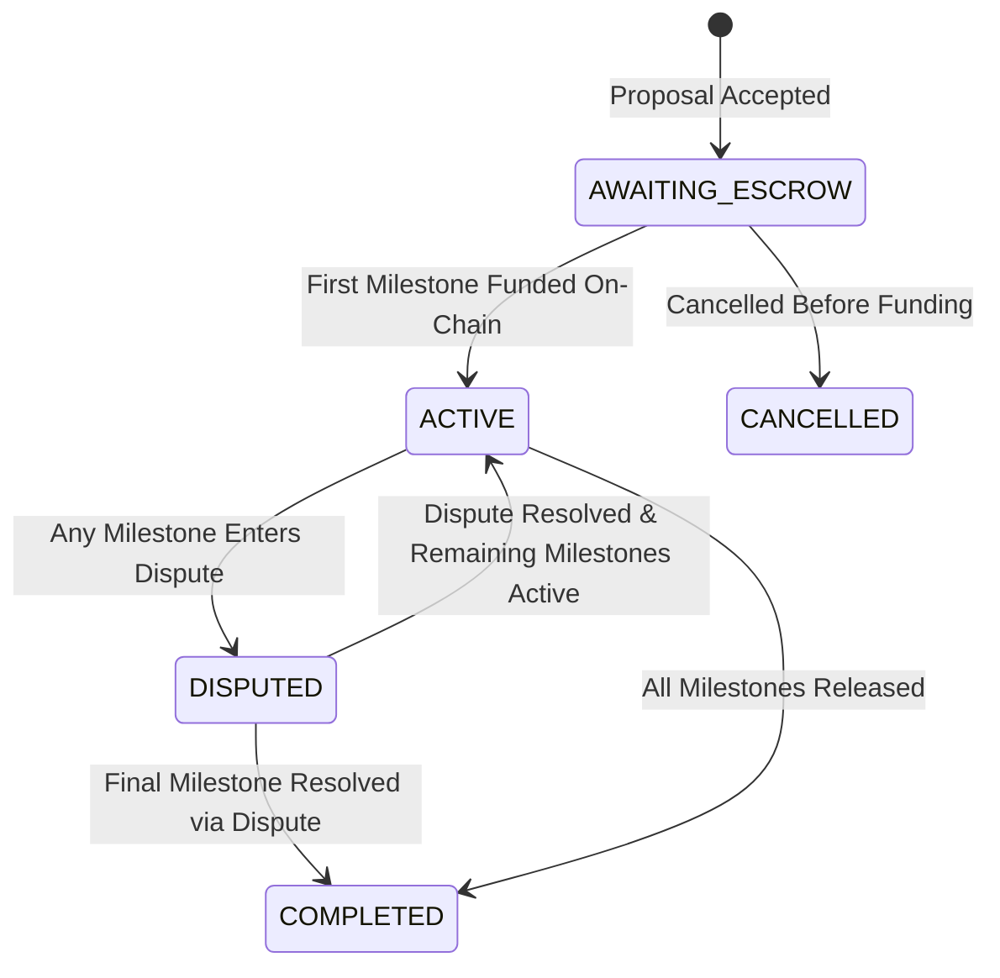
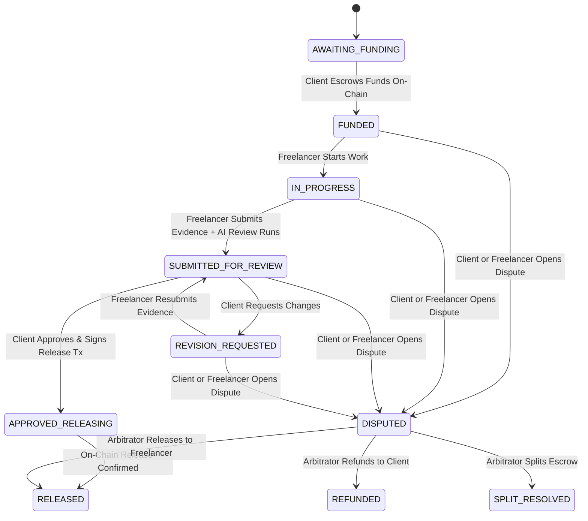

# Projects & Milestones Specification

> **Classification:** Feature Technical Specification  
> **Status:** `Prototype Only` (`src/app/jobs/[jobId]/job-view.tsx`, `html/projects.html`, `html/milestones.html`)  
> **Target Milestone:** [MILESTONE_03_PROJECT_MANAGEMENT.md](../milestones/MILESTONE_03_PROJECT_MANAGEMENT.md)  
> **Last Updated:** 2026-11-09  

---

## 1. Current Repository State

- **`src/` (Next.js App):** `/jobs/[jobId]` (`src/app/jobs/[jobId]/job-view.tsx`) conflates a marketplace `Job` and an active `Project` into a single object in `src/lib/patela-store.ts`.
- **`html/` (Dashboard Prototype):** `html/projects.html` and `html/milestones.html` separate active contracts (`Project`) and milestone timelines (`Milestone`), including full-screen detail views with interactive SVG progress rings and deliverable checklists.

---

## 2. Domain State Machines

### 2.1 Project Lifecycle States

### 2.2 Milestone Lifecycle States

---

## 3. Core Invariants

1. **No Unfunded Work Submission:** A freelancer cannot submit deliverable evidence (`POST /api/v1/milestones/:id/submissions`) unless the milestone status is `FUNDED`, `IN_PROGRESS`, or `REVISION_REQUESTED` with a confirmed on-chain escrow deposit (`EscrowDeposit.status === 'CONFIRMED'`).
2. **Sequential or Independent Milestone Funding:** Clients may fund the entire project upfront (all milestones in one batch transaction or individual milestone deposits) or fund milestones sequentially before each phase begins.
3. **Immutable Funded Terms:** Once a milestone is `FUNDED` on-chain, its `amount`, `paymentToken`, and `freelancerWallet` cannot be mutated without mutual cancellation/refund.
4. **Completion Rollup:** A `Project` automatically transitions to `COMPLETED` when every milestone in `project.milestones` has reached a terminal state (`RELEASED`, `REFUNDED`, or `SPLIT_RESOLVED`).

---

## 4. API Endpoints

| Method | Endpoint | Auth | Description |
|---|---|---|---|
| `GET` | `/api/v1/projects` | JWT | List projects where user is `clientId` or `freelancerId` |
| `GET` | `/api/v1/projects/:projectId` | JWT (Participant) | Fetch full project workspace, milestones, escrow status, and activity log |
| `GET` | `/api/v1/milestones/:milestoneId` | JWT (Participant) | Fetch single milestone detail, submissions, AI reports, and transactions |
| `POST` | `/api/v1/milestones/:milestoneId/start` | JWT (`FREELANCER`) | Transition a `FUNDED` milestone to `IN_PROGRESS` |
| `POST` | `/api/v1/milestones/:milestoneId/request-revision` | JWT (`CLIENT`) | Transition `SUBMITTED_FOR_REVIEW` to `REVISION_REQUESTED` with structured feedback |

---

## 5. Acceptance Criteria

- [ ] Attempting to submit deliverables to an `AWAITING_FUNDING` milestone returns `409 Conflict`.
- [ ] Every milestone status transition writes an immutable `AuditLog` entry with actor ID, previous status, new status, and timestamp.
- [ ] Client revision requests require a non-empty feedback note (`min 20 chars`) and notify the freelancer in real time.

